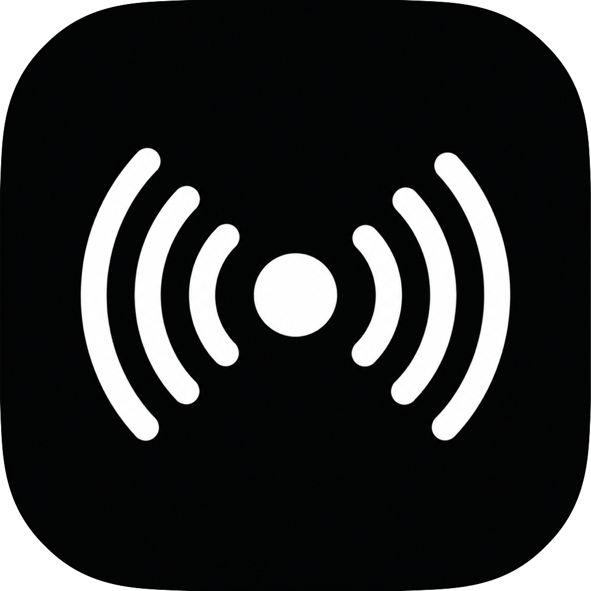
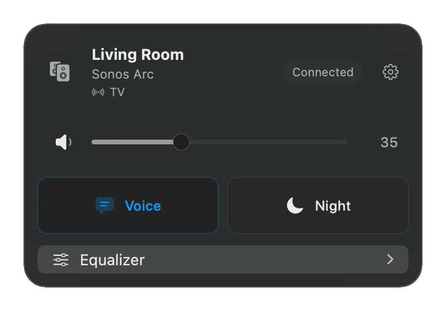
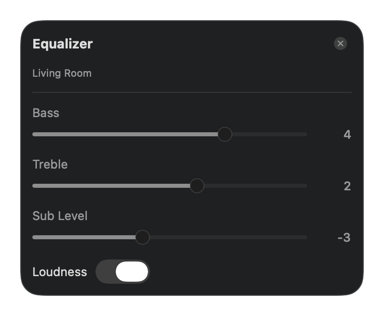
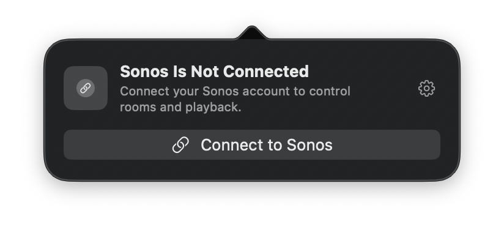

<div align="center">
  

  <h1>Sonos Macbar</h1>

  <p>
    Quick Sonos control from your macOS menu bar.<br />
    Small, native, and designed to stay out of your way.
  </p>

  <p>
    <a href="#features">Features</a> ·
    <a href="#screenshots">Screenshots</a> ·
    <a href="#install">Install</a> ·
    <a href="#uninstall">Uninstall</a>
  </p>

  <p>
    
    
    
  </p>
</div>

## Features

- 🔊 Control speaker volume directly from the menu bar
- 📡 See the current playback source at a glance
- 🔁 Keep the volume slider in sync with external remote changes
- 🔇 Mute your Sonos with one click
- 🎚️ Adjust bass, treble and loudness in a dedicated Equalizer view. Rooms with a bonded Sonos Sub or Sub Mini also get a Sub level slider.
- 🗣️ Toggle Voice enhancement
- 🌙 Toggle Night mode
- 🏠 Choose between Sonos rooms
- 🔐 Sign in once through the official Sonos OAuth flow
- 🔑 Store credentials securely in the macOS Keychain

## Screenshots

<div align="center">
  
  &nbsp;&nbsp;
  
</div>

<div align="center">
  
  &nbsp;&nbsp;
  
</div>

## How it works

1. Start **Sonos Macbar**.
2. Click the Sonos icon in the macOS menu bar.
3. Connect your Sonos account in the browser.
4. Control your speaker without opening the full Sonos app.

No tokens need to be copied or pasted. The app keeps the connection in the
macOS Keychain.

Select **Equalizer** in the control panel to open a separate view for the
selected room. Bass, treble and Sub level use the same slider design as the
volume control. Select **×** to return to the control panel.

Your Mac and Sonos speaker must be on the same local network. If prompted,
allow local network access under **System Settings → Privacy & Security →
Local Network**.

## Install

The prebuilt release requires an Apple silicon Mac with macOS 14 or later.

Install with Homebrew:

```bash
brew tap AntoinS/sonos_macbar \
  https://github.com/AntoinS/sonos_macbar.git
brew install --cask antoins/sonos_macbar/sonos-macbar
```

### First launch on macOS

The current release is not yet signed and notarized by Apple. If macOS shows
the message that Apple cannot check **Sonos Macbar**, open **System Settings →
Privacy & Security** and click **Open Anyway**. Confirm the dialog once; future
launches should work normally on that Mac.

Alternatively, after installing with Homebrew, run:

```bash
xattr -dr com.apple.quarantine "/Applications/Sonos Macbar.app"
open "/Applications/Sonos Macbar.app"
```

This one-time step removes the download quarantine from the local copy.

Or build the app manually:

Build the app:

```bash
bash scripts/build_app.sh
```

Copy it to Applications:

```bash
cp -R "dist/Sonos Macbar.app" /Applications/
```

Then open **Sonos Macbar** from `/Applications`. It runs as a menu bar app and
does not open a normal Dock window.

### Updates

Open **Settings → Updates → Check for Updates** to check the latest stable
GitHub release. **Update with Homebrew** runs the upgrade in Terminal. If you
installed the app manually, download the ZIP, quit Sonos Macbar and replace
the app in Applications.

See [GitHub Releases](https://github.com/AntoinS/sonos_macbar/releases) for
patch notes and downloads.

## Uninstall

If installed with Homebrew:

```bash
brew uninstall --cask sonos-macbar
```

If installed manually, remove **Sonos Macbar.app** from `/Applications`.

## License

Sonos Macbar is available under the MIT License. See [LICENSE](LICENSE).

<div align="center">
  <sub>Built with SwiftUI for macOS.</sub>
</div>
