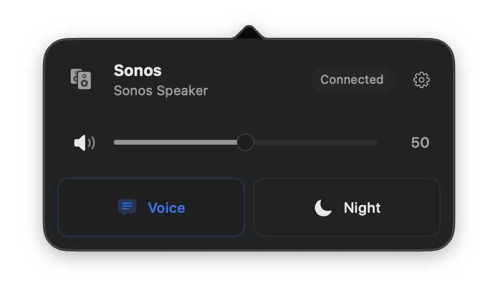
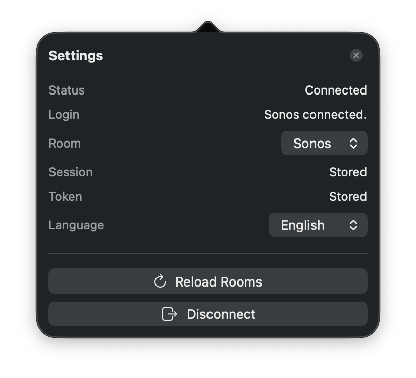

<div align="center">
  

  <h1>Sonos Macbar</h1>

  <p>
    Quick Sonos control from your macOS menu bar.<br />
    Small, native, and designed to stay out of your way.
  </p>

  <p>
    <a href="#features">Features</a> ·
    <a href="#screenshots">Screenshots</a> ·
    <a href="#install">Install</a> ·
    <a href="#development">Development</a>
  </p>

  <p>
    
    
    
  </p>
</div>

## Features

- 🔊 Control speaker volume directly from the menu bar
- 🔇 Mute your Sonos with one click
- 🗣️ Toggle Voice enhancement
- 🌙 Toggle Night mode
- 🏠 Choose between Sonos rooms
- 🔐 Sign in once through the official Sonos OAuth flow
- 🔑 Store credentials securely in the macOS Keychain

## Screenshots

<div align="center">
  
  &nbsp;&nbsp;
  
</div>

## How it works

1. Start **Sonos Macbar**.
2. Click the Sonos icon in the macOS menu bar.
3. Connect your Sonos account in the browser.
4. Control your speaker without opening the full Sonos app.

No tokens need to be copied or pasted. The app keeps the connection in the
macOS Keychain.

## Install

Install with Homebrew:

```bash
brew tap AntoinS/sonos_macbar \
  https://github.com/AntoinS/sonos_macbar.git
brew install --cask --no-quarantine antoins/sonos_macbar/sonos-macbar
```

The `--no-quarantine` option is a free workaround for testing unsigned builds
and bypasses macOS Gatekeeper's quarantine check. A Developer ID signature and
Apple notarization are required for a warning-free public release.

Or build the app manually:

Build the app:

```bash
bash scripts/build_app.sh
```

Copy it to Applications:

```bash
cp -R "dist/Sonos Macbar.app" /Applications/
```

Then open **Sonos Macbar** from `/Applications`. It runs as a menu bar app and
does not open a normal Dock window.

## Uninstall

If installed with Homebrew:

```bash
brew uninstall --cask sonos-macbar
```

If installed manually, remove **Sonos Macbar.app** from `/Applications`.

## License

Sonos Macbar is available under the MIT License. See [LICENSE](LICENSE).

<div align="center">
  <sub>Built with SwiftUI for macOS.</sub>
</div>
