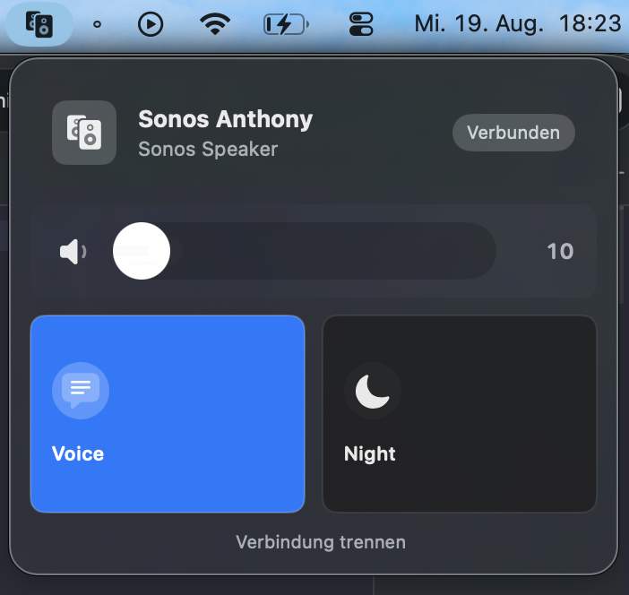
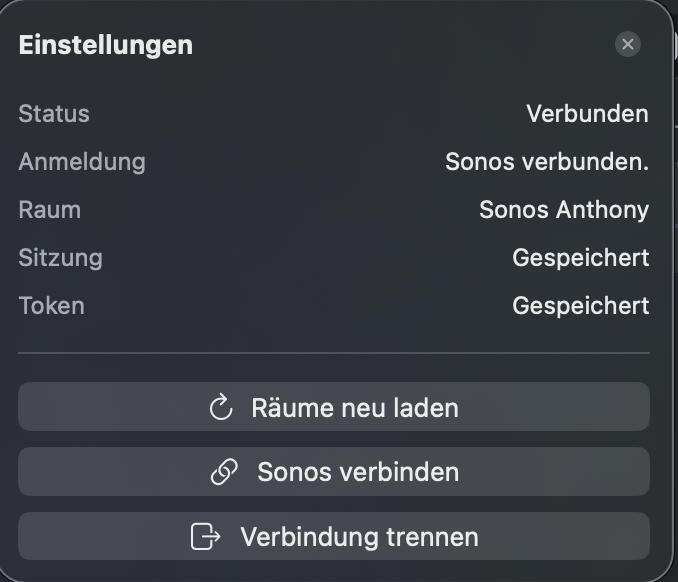

# Sonos Macbar

A small native macOS menu bar app for Sonos. It lives in the menu bar and gives
you quick access to volume, mute, speech enhancement, and night sound without
opening the full Sonos app. 🎵



## What It Does

- 🔊 Control Sonos volume directly from the macOS menu bar
- 🔇 Mute your Sonos system with the speaker button
- 🗣️ Toggle speech enhancement
- 🌙 Toggle night sound
- 🏠 View and switch the active Sonos room
- 🔐 Connect once with your Sonos account in the browser
- 🧰 Open settings directly from the menu bar panel

## Why?

Sonos is great, but the full app can feel heavy for small actions. Sonos Macbar
is built for quick everyday control: change the volume, mute playback, enable
speech enhancement, or switch on night sound in a few seconds.

The interface is intentionally minimal and macOS-like: clear states, quiet
controls, and no token-copying setup for normal users.

## Screenshots

### Control Panel


### Settings



## Sign In

Sign-in uses the official Sonos OAuth flow in the browser. Normal users do not
need to find, copy, or paste any token.

1. Launch the app.
2. Open the Sonos Macbar menu bar panel.
3. Click **Connect Sonos**.
4. Sign in with Sonos in the browser and allow access.
5. Return to the app.

The app stores only local session state and short-lived Sonos access tokens in
the macOS Keychain. No Sonos client secret is stored in the app.

## Settings

From the settings view you can:

- check the connection status
- see the active room
- reload available rooms
- switch rooms
- disconnect the Sonos account
- reconnect when the current session is no longer valid

## Technical Overview

The app uses an OAuth broker at:

```text
https://sonos-auth.alania-bonn.de
```

The broker handles the server-side Sonos OAuth token exchange. This keeps the
Sonos client secret out of the macOS app.

Relevant endpoints:

- `GET /health`
- `POST /oauth/start`
- `GET /oauth/status/{loginId}`
- `POST /token`
- `GET /oauth/callback`

Server-side implementation notes are documented in
[SONOS_AUTH_SERVER_HANDOFF.md](SONOS_AUTH_SERVER_HANDOFF.md).

## Development

Requirements:

- macOS 14 or later
- Xcode
- Swift Package Manager

Build locally:

```bash
swift build
```

Run the app:

```bash
swift run sonos_macbar
```

For local development without the OAuth broker, debug builds can use a temporary
Sonos access token:

```bash
export SONOS_ACCESS_TOKEN="YOUR_LOCAL_ACCESS_TOKEN"
swift run sonos_macbar
```

The Keychain session takes priority over this debug fallback.

## Security

Before committing, run the lightweight secret scan:

```bash
bash scripts/check_secrets.sh
```

The check looks for accidentally committed access tokens, refresh tokens, client
secrets, and authorization headers.

## Known Server Dependency

If the Sonos page keeps showing a loading spinner after the user allows access,
the issue is usually not in the macOS app. The OAuth broker must make sure that
`/oauth/callback` returns a final HTML response or redirect after the token
exchange and marks the login session as `complete`.
