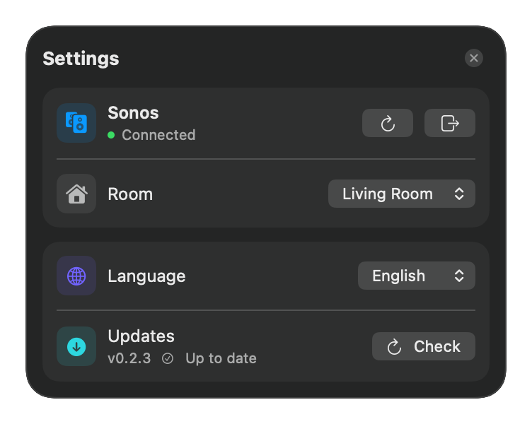

# Sonos Macbar

Sonos Macbar is a small macOS menu bar app for quick Sonos control. It lets you
change volume, mute your speaker, and switch Voice or Night mode without opening
the full Sonos app. 🎵

## Features

- 🔊 Control volume from the menu bar
- 🔇 Mute Sonos with one click
- 🗣️ Toggle Voice mode
- 🌙 Toggle Night mode
- 🏠 Choose your Sonos room
- 🔐 Sign in once with your Sonos account

## Screenshots

### Control Panel


### Settings



## How It Works

1. Start **Sonos Macbar**.
2. Click the Sonos icon in the macOS menu bar.
3. Connect your Sonos account in the browser.
4. Control your speaker directly from the menu bar.

You do not need to copy or paste any tokens. The app stores the connection
securely in the macOS Keychain.

## Settings

The settings view lets you:

- switch rooms
- reload rooms
- check the connection status
- disconnect your Sonos account

## Install

Build the app:

```bash
bash scripts/build_app.sh
```

Copy it to Applications:

```bash
cp -R "dist/Sonos Macbar.app" /Applications/
```

Then open **Sonos Macbar** from `/Applications`. It appears in the menu bar, not
as a normal Dock window.

## Development

Requirements:

- macOS 14 or later
- Xcode
- Swift Package Manager

Run locally:

```bash
swift run sonos_macbar
```

Before committing, run:

```bash
bash scripts/check_secrets.sh
```
